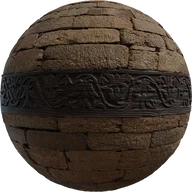
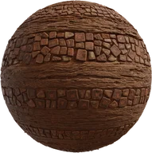
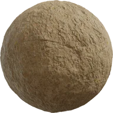

# Poly Haven: Stone textures

**3 assets from [Poly Haven](https://polyhaven.com), dedicated to the public domain under [CC0](https://polyhaven.com/license).** Use them in any game, free or paid, and change them however you like; no credit is needed.

PBR textures as 1K and 2K JPG maps (colour, normal (GL and DX), roughness, AO, displacement and more). 70.9 MB in all.

This is a copy kept by [zuujis-cc0](https://github.com/zuujis-cc0) so game makers can take single files from GitHub. It is not made by or affiliated with Poly Haven: the originals, often in more formats and higher resolutions, are on [polyhaven.com](https://polyhaven.com). If they help you, consider [supporting Poly Haven](https://www.patreon.com/polyhaven/overview).

Every file is listed in [MANIFEST.tsv](MANIFEST.tsv) with its size and SHA-256. More free assets: [the Zuujis collection](https://github.com/zuujis-cc0/free-game-assets#readme).

| | | | |
| :-: | :-: | :-: | :-: |
|  <b><a href="wood_inlaid_stone_wall">Wood Inlaid Stone Wall</a></b> by Amal Kumar · <a href="https://polyhaven.com/a/wood_inlaid_stone_wall">source</a> |  <b><a href="wood_stone_pathway">Wood Stone Pathway</a></b> by Dimitrios Savva · <a href="https://polyhaven.com/a/wood_stone_pathway">source</a> |  <b><a href="worn_rock_natural_01">Worn Rock Natural 01</a></b> by Dimitrios Savva, Rob Tuytel · <a href="https://polyhaven.com/a/worn_rock_natural_01">source</a> |  |

---

Kept up to date by this repository's own [update workflow](.github/workflows/update.yml), with code and plan from [cc0-mirror](https://github.com/zuujis-cc0/cc0-mirror). Something wrong? [Open an issue there](https://github.com/zuujis-cc0/cc0-mirror/issues/new) or use the [private report form](https://games.zuujis.com/report).
